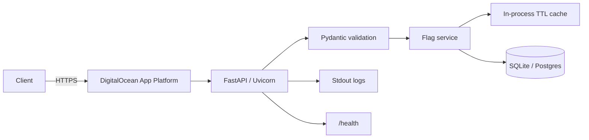
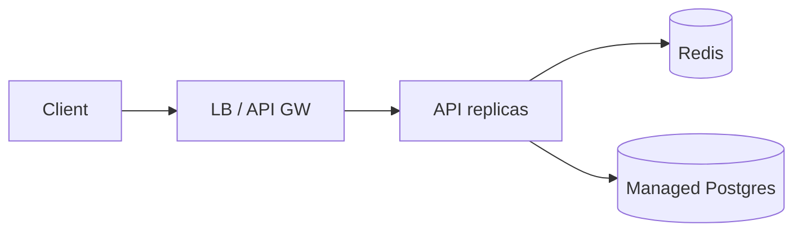

# Feature Flags API — Design

## Requirements

### Functional (MVP)

- Create and persist feature flags (`key`, `description`, `enabled` default).
- Enable/disable a flag globally.
- Enable/disable a flag for a specific user (override).
- Evaluate whether a flag is enabled for a user (override → else global default).
- Cache evaluations/flag data; invalidate on writes.
- Sensible HTTP status codes (`200`, `201`, `204`, `400`, `404`, `409`, `422`, `500`, `503`).

### Deferred

Percentage rollouts, cohorts, Redis, auth, multi-tenant, audit log, SDKs, webhooks, workers/queues.

### Assumptions

- No auth for the interview demo.
- Missing flag on evaluate → `404`.
- DigitalOcean App Platform, single instance.
- In-process TTL cache (not Redis).
- SQLite by default; `DATABASE_URL` can point at Postgres later.

## Non-functional

| Quality | Prototype target |
|---------|------------------|
| Correctness | Deterministic precedence; write-through cache invalidation; tests |
| Durability | SQLite/Postgres via SQLAlchemy |
| Latency | Warm-cache evaluate without DB round-trip |
| Consistency | Unique constraints; last-write-wins on concurrent updates |
| Deployability | Docker + App Platform + `/health` + GitHub Actions |

## Core entities

### FeatureFlag

- Fields: `id`, `key`, `description`, `enabled`, `created_at`, `updated_at`
- Constraints: `UNIQUE(key)`, `key` pattern `^[a-zA-Z0-9][a-zA-Z0-9._-]{0,63}$`
- Relations: 1 → N `UserOverride`

### UserOverride

- Fields: `id`, `flag_id`, `user_id`, `enabled`, `created_at`, `updated_at`
- Constraints: `UNIQUE(flag_id, user_id)`, FK cascade delete
- Precedence: override wins over global `enabled`

## API contract

| Method | Path | Notes |
|--------|------|-------|
| `POST` | `/flags` | Create; `409` on duplicate key |
| `GET` | `/flags` | List |
| `GET` | `/flags/{key}` | Get; `404` if missing |
| `PATCH` | `/flags/{key}` | Update `enabled` and/or `description` |
| `PUT` | `/flags/{key}/users/{user_id}` | Upsert override |
| `DELETE` | `/flags/{key}/users/{user_id}` | Remove override; `404` if missing |
| `GET` | `/evaluate/{key}?user_id=` | Evaluate; returns `source`, `cached` |
| `GET` | `/health` | DB connectivity check |

## Data flow

1. **Create/update:** validate → DB transaction → commit → invalidate cache → respond.
2. **Evaluate (miss):** validate → load flag → load override → compute → cache → respond (`cached: false`).
3. **Evaluate (hit):** cache → respond (`cached: true`).
4. **Duplicate create:** unique violation → `409`.
5. **Startup:** load env → init DB → init cache → bind `0.0.0.0:$PORT`.

## Architecture

### Production evolution (not implemented)

## Technology stack

Python 3.12 · FastAPI · Pydantic · SQLAlchemy · SQLite · cachetools · pytest · Uvicorn · Docker · DigitalOcean App Platform · GitHub Actions

## Tradeoffs

| Decision | Choice | Why |
|----------|--------|-----|
| Cache | In-process TTL | Meets caching requirement without Redis |
| DB | SQLite | Fastest DO single-instance path |
| Shape | Modular monolith | Three-hour scope |
| Auth | None | Demo velocity; document as gap |

## Known limitations

- Cache is not shared across processes/replicas — run **one** instance with SQLite.
- No authentication.
- Last-write-wins under concurrent updates.
- `create_all` used for schema bootstrap (Alembic deferred).

## Testing strategy

- Create / duplicate / validation / 404 paths
- Global vs override evaluation precedence
- Cache invalidation after write
- `/health`
- Integration tests via FastAPI `TestClient` + temp SQLite

## Scaling plan

Keep monolith until multi-instance HA is required, then: managed Postgres + Redis shared cache + optional edge rate limits. No queue unless async side effects appear.

## Implementation milestones

1. Scaffold + DESIGN
2. Models, service, cache, routes (MVP E2E)
3. Tests + CI
4. Docker + App Platform config + README
5. Deploy smoke + review notes
