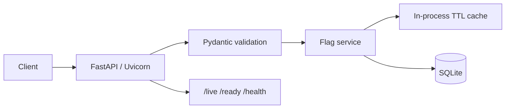
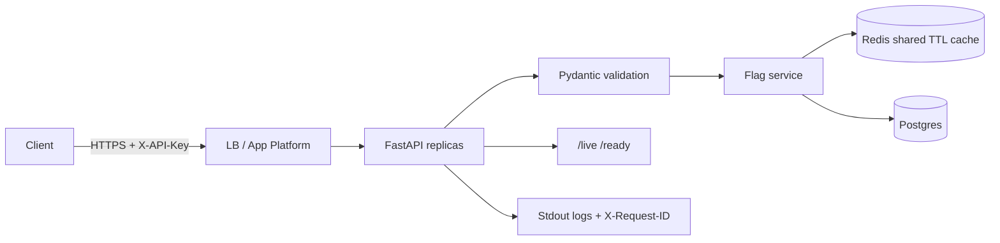

# Feature Flags API — Design

## Requirements

### Functional (MVP)

- Create and persist feature flags (`key`, `description`, `enabled` default).
- Enable/disable a flag globally.
- Enable/disable a flag for a specific user (override).
- Evaluate whether a flag is enabled for a user (override → else global default).
- Cache evaluations/flag data; invalidate on writes.
- Sensible HTTP status codes (`200`, `201`, `204`, `400`, `404`, `409`, `422`, `500`, `503`).

### Deferred

Percentage rollouts, cohorts, multi-tenant RBAC/OIDC, audit log, SDKs, webhooks, workers/queues.

### Assumptions

- Missing flag on evaluate → `404`.
- Dev defaults: SQLite + in-process TTL cache; API key optional.
- Production: Postgres + Redis + required `API_KEY`; multi-instance safe.
- DigitalOcean App Platform (or docker compose) for deploy.

## Non-functional

| Quality | Prototype target |
|---------|------------------|
| Correctness | Deterministic precedence; write-through cache invalidation; tests |
| Durability | SQLite/Postgres via SQLAlchemy + Alembic |
| Latency | Warm-cache evaluate without DB round-trip |
| Consistency | Unique constraints; last-write-wins on concurrent updates |
| Deployability | Docker + App Platform + `/live` `/ready` + GitHub Actions |

## Core entities

### FeatureFlag

- Fields: `id`, `key`, `description`, `enabled`, `created_at`, `updated_at`
- Constraints: `UNIQUE(key)`, `key` pattern `^[a-zA-Z0-9][a-zA-Z0-9._-]{0,63}$`
- Relations: 1 → N `UserOverride`

### UserOverride

- Fields: `id`, `flag_id`, `user_id`, `enabled`, `created_at`, `updated_at`
- Constraints: `UNIQUE(flag_id, user_id)`, FK cascade delete
- Precedence: override wins over global `enabled`

## API contract

| Method | Path | Notes |
|--------|------|-------|
| `POST` | `/flags` | Create; `409` on duplicate key |
| `GET` | `/flags` | List |
| `GET` | `/flags/{key}` | Get; `404` if missing |
| `PATCH` | `/flags/{key}` | Update `enabled` and/or `description` |
| `PUT` | `/flags/{key}/users/{user_id}` | Upsert override |
| `DELETE` | `/flags/{key}/users/{user_id}` | Remove override; `404` if missing |
| `GET` | `/evaluate/{key}?user_id=` | Evaluate; returns `source`, `cached` |
| `GET` | `/live` | Liveness (no deps) |
| `GET` | `/ready` | DB + cache readiness |
| `GET` | `/health` | DB check (compat) |

## Data flow

1. **Create/update:** validate → DB transaction → commit → invalidate cache → respond.
2. **Evaluate (miss):** validate → load flag → load override → compute → cache → respond (`cached: false`).
3. **Evaluate (hit):** cache → respond (`cached: true`).
4. **Duplicate create:** unique violation → `409`.
5. **Startup:** load env → init DB → init cache → bind `0.0.0.0:$PORT`.

## Architecture

### Development (default)

### Production (`ENVIRONMENT=production` + docker compose / App Platform)

Production boot **fails fast** unless Postgres, Redis, and `API_KEY` are configured.

## Technology stack

Python 3.12 · FastAPI · Pydantic · SQLAlchemy · Alembic · Postgres (prod) / SQLite (dev) · Redis (prod) / cachetools memory (dev) · pytest · Uvicorn · Docker Compose · DigitalOcean App Platform · GitHub Actions

## Tradeoffs

| Decision | Choice | Why |
|----------|--------|-----|
| Cache | Redis in prod, memory in dev | Shared coherency across replicas |
| DB | Postgres in prod, SQLite in dev | Concurrent writes + HA |
| Shape | Modular monolith | Enough until async side effects appear |
| Auth | API key when configured | Simple shared-secret for service-to-service |
| Migrations | Alembic | Repeatable schema changes |

## Known limitations

- API key is shared-secret (not OIDC / per-tenant RBAC).
- Last-write-wins under concurrent updates (no optimistic versioning).
- Redis `SCAN` invalidation is good enough at interview/prod-early scale; key versioning is a later optimization.
- No rate limiting / WAF yet — put at the gateway if needed.
- No audit log, percentage rollouts, or webhooks.

## Testing strategy

- Create / duplicate / validation / 404 paths
- Global vs override evaluation precedence
- Cache invalidation after write
- `/live`, `/ready`, `/health`
- API-key auth when configured
- Integration tests via FastAPI `TestClient` + temp SQLite + memory cache

## Scaling plan

Already supports multi-instance via Postgres + Redis. Next increments: gateway rate limits, managed Redis failover, read replicas, OIDC, optional queue for webhooks/audit.
