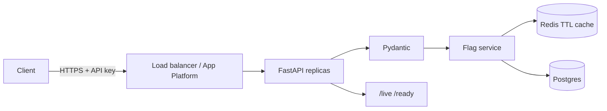

# Feature Flags API

Production-minded REST API for feature flags: global + per-user state, cached evaluation, Postgres + Redis ready, API-key auth.

See [DESIGN.md](DESIGN.md) for architecture and tradeoffs ([docs/](docs/DESIGN.md) points here too).

## Modes

| Mode | DB | Cache | Auth |
|------|----|-------|------|
| **Development** (default) | SQLite | In-process TTL | Optional (`API_KEY`) |
| **Production** (`ENVIRONMENT=production`) | Postgres required | Redis required | API key required |

Production boot **refuses to start** if SQLite, missing Redis, or missing `API_KEY`.

## Quick start (dev)

```bash
python -m venv .venv && source .venv/bin/activate
pip install -r requirements.txt
cp .env.example .env
uvicorn app.main:app --host 0.0.0.0 --port 8080 --reload
```

Docs: http://127.0.0.1:8080/docs

## Production-like local stack

```bash
docker compose up --build
```

Then:

```bash
curl -s http://127.0.0.1:8080/ready
curl -s -X POST http://127.0.0.1:8080/flags \
  -H 'content-type: application/json' \
  -H 'X-API-Key: dev-change-me' \
  -d '{"key":"new-checkout","enabled":false}'
curl -s 'http://127.0.0.1:8080/evaluate/new-checkout?user_id=alice' \
  -H 'X-API-Key: dev-change-me'
```

## API

| Method | Path | Notes |
|--------|------|-------|
| `GET` | `/live` | Liveness (no deps) |
| `GET` | `/ready` | DB + cache readiness |
| `GET` | `/health` | DB check (compat) |
| `POST` | `/flags` | Create (`409` duplicate) |
| `GET` | `/flags` | List |
| `GET` | `/flags/{key}` | Get |
| `PATCH` | `/flags/{key}` | Update global state |
| `PUT` | `/flags/{key}/users/{user_id}` | Upsert override |
| `DELETE` | `/flags/{key}/users/{user_id}` | Remove override |
| `GET` | `/evaluate/{key}?user_id=` | Evaluate (`source`, `cached`) |

When `API_KEY` is set, send `X-API-Key` on all non-public routes. Public: `/live`, `/ready`, `/health`, `/docs`.

**Precedence:** user override → else global default → missing flag → `404`.

## Tests

```bash
pytest -q
```

## Architecture



## DigitalOcean

1. Provision managed Postgres + managed Redis/Valkey.
2. Set secrets: `DATABASE_URL`, `REDIS_URL`, `API_KEY`, `ENVIRONMENT=production`.
3. Deploy via `.do/app.yaml` (update GitHub repo) or App Platform UI; health path `/ready`.
4. Scale to 2+ instances — safe with Postgres + Redis.

```bash
doctl apps create --spec .do/app.yaml
```

## CI

GitHub Actions runs `pytest` on push/PR.
