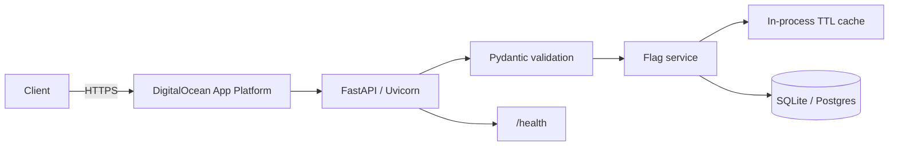

# Feature Flags API

Production-minded REST API for storing feature flags, managing global and per-user state, and evaluating availability with an in-process TTL cache.

See [DESIGN.md](DESIGN.md) (also [docs/DESIGN.md](docs/DESIGN.md)) for requirements, architecture, tradeoffs, and scaling notes.

## Quick start

```bash
python -m venv .venv
source .venv/bin/activate
pip install -r requirements.txt
cp .env.example .env
uvicorn app.main:app --host 0.0.0.0 --port 8080 --reload
```

Open docs at http://127.0.0.1:8080/docs

## API overview

| Method | Path | Purpose |
|--------|------|---------|
| `POST` | `/flags` | Create flag |
| `GET` | `/flags` | List flags |
| `GET` | `/flags/{key}` | Get flag |
| `PATCH` | `/flags/{key}` | Update global state/description |
| `PUT` | `/flags/{key}/users/{user_id}` | Upsert per-user override |
| `DELETE` | `/flags/{key}/users/{user_id}` | Remove override |
| `GET` | `/evaluate/{key}?user_id=` | Evaluate for user (cached) |
| `GET` | `/health` | Liveness / DB check |

### Evaluation precedence

1. Per-user override, if present  
2. Otherwise global `enabled`  
3. Unknown flag → `404`

### Example

```bash
curl -s -X POST http://127.0.0.1:8080/flags \
  -H 'content-type: application/json' \
  -d '{"key":"new-checkout","description":"Checkout redesign","enabled":false}'

curl -s -X PUT http://127.0.0.1:8080/flags/new-checkout/users/alice \
  -H 'content-type: application/json' \
  -d '{"enabled":true}'

curl -s 'http://127.0.0.1:8080/evaluate/new-checkout?user_id=alice'
```

## Tests

```bash
pytest -q
```

## Docker

```bash
docker build -t feature-flags-api .
docker run --rm -p 8080:8080 \
  -e PORT=8080 \
  -e DATABASE_URL=sqlite:////tmp/feature_flags.db \
  feature-flags-api
```

## DigitalOcean App Platform

1. Push this repo to GitHub.
2. Update `.do/app.yaml` `services[0].github.repo` to your repo.
3. Create the app:

```bash
doctl apps create --spec .do/app.yaml
```

Or use the App Platform UI: **Create App → GitHub → Dockerfile**, set HTTP port `8080`, health check `/health`, and env vars from `.env.example` (use `sqlite:////tmp/feature_flags.db` on the platform).

**Constraint:** run a **single instance**. SQLite + in-process cache are not safe across replicas. For HA, switch to managed Postgres + Redis (see DESIGN.md).

## CI

GitHub Actions (`.github/workflows/ci.yml`) runs `pytest` on push/PR.

## Architecture



## Interview review notes

**60-second walkthrough:** FastAPI monolith persists flags and per-user overrides in SQLite, evaluates with override-over-default precedence, caches results in a process-local TTL cache, and invalidates that cache on every write. Deployed as one Docker service on App Platform with `/health` and GitHub Actions tests.

**Strongest decisions:** (1) in-process cache meets the caching requirement without Redis, (2) unique DB constraints for correctness, (3) invalidate-on-write for freshness, (4) single instance matches SQLite, (5) thin service layer easy to defend.

**Limitations:** no auth, no shared cache, SQLite write contention, no Alembic yet, last-write-wins concurrency.
